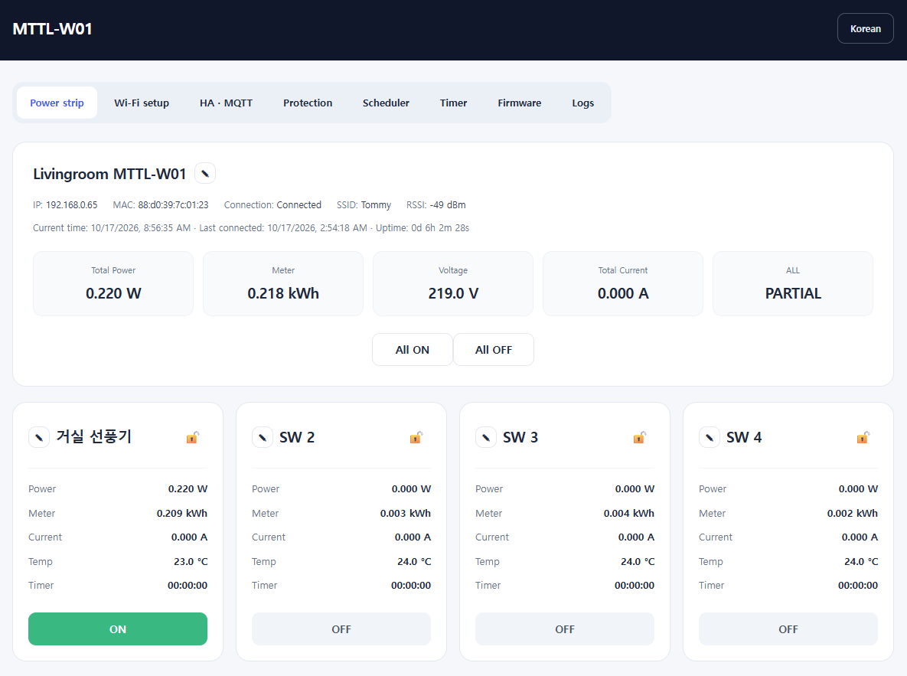
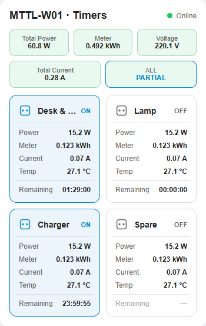
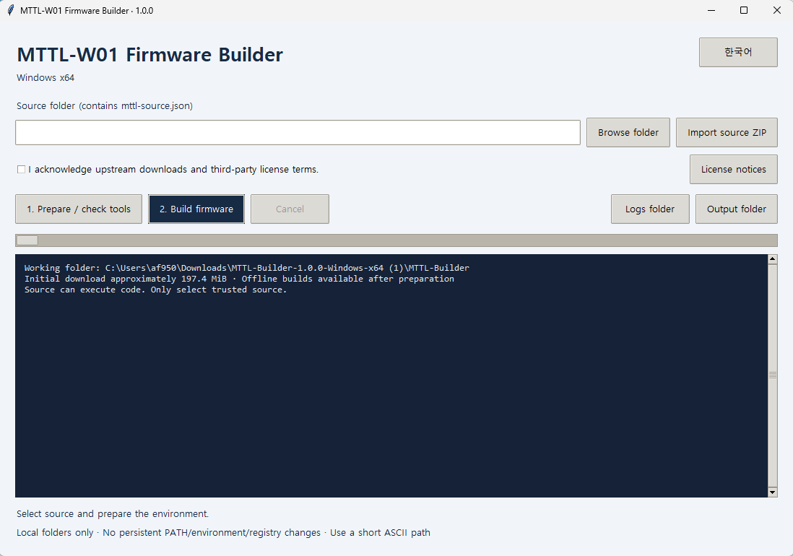
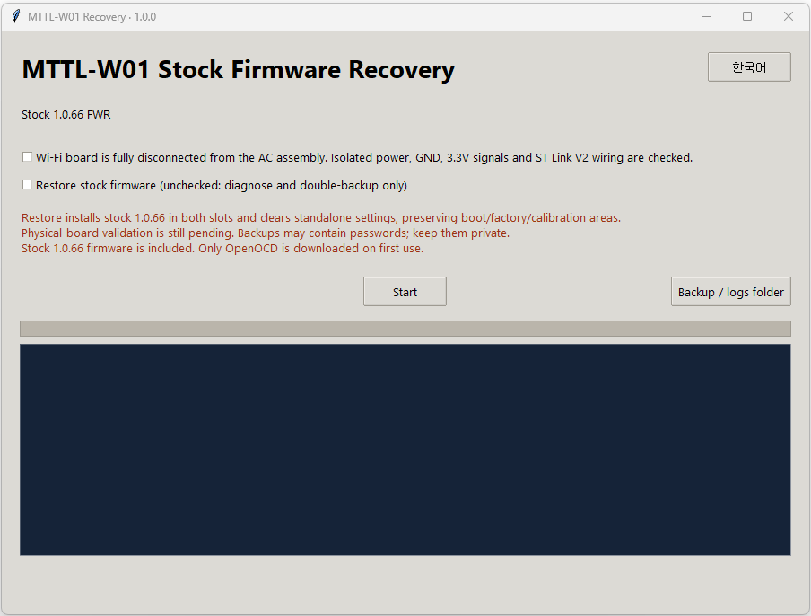

# MTTL-W01 Standalone Firmware

한국어 | [English](README_EN.md)

> **2.0.x 사용자는 2.1.x 이상으로 업그레이드를 권장합니다.** 2.0.x는 설정·누적량을 소수의 고정 플래시 섹터에 반복 저장하므로, 장기간 사용하면 해당 섹터의 마모가 누적될 수 있습니다. 2.1.x은 128KiB 순환 저장과 매 정시 누적량 저장으로 소거 빈도를 줄이고 마모를 분산합니다. 기존 기기의 플래시 수명이 이미 소진되었다는 의미는 아닙니다. **2.0.x에서 2.1.x으로 처음 전환하면 기존 설정·누적량은 이전되지 않으며, Wi-Fi 등 설정을 다시 진행해야 합니다.**

프로젝트 자체 코드는 [MIT 라이선스](LICENSE)로 제공합니다. 제3자 구성 요소는 기존 조건을 유지합니다. [적용 범위](LICENSING.md)

## 빌드된 펌웨어 — 바로 설치하기

직접 빌드할 필요 없이 아래 FWR 파일을 다운로드하여 설치할 수 있습니다.

LG U+ MTTL-W01을 별도 백엔드 서버나 DNAT 없이 Wi-Fi 웹 대시보드와
MQTT로 Home Assistant에 연결하는 독립 펌웨어입니다.

### 펌웨어 다운로드

**2.1.1 / build `33231c0032fa013b` · 2026-10-22**

[comMTTL-W01_2.1.1.fwr 다운로드](firmware/comMTTL-W01_2.1.1.fwr)

SHA-256: `362f92df30f16fadcfd012ba20557ce58466f08706e99bca6cf6e1f67ae1ce9f`

> **2.1.x 최초 설치 주의:** 2.0.x 설정·누적량을 이전하지 않습니다. 재부팅 후 `MTTL-W01-SETUP`에 연결해 Wi-Fi부터 다시 설정하십시오. 이전 IP로 자동 복귀하지 않을 수 있습니다. 2.0.x 웹 다운그레이드는 지원하지 않으며, 기존 복구 툴 1.0.0은 새 저장 형식에 미대응입니다.

기존 독립 펌웨어 사용자는 기기 웹의 **펌웨어** 탭에서 위 파일로 업데이트할 수 있습니다.

모든 하드웨어 변형에 대한 호환성을 보증하지 않습니다. 설치 실패 시
디버거를 이용한 복구가 필요할 수 있습니다. 소프트웨어 보호는 하드웨어 안전 보호 장치를 대체하지 않습니다.
테스트 기기에서 1000W 제한과 드라이어 부하로 고전력 차단을 확인했습니다. 전류·온도 차단과 계측 정확성은 별도 실기 검증 전입니다.

### 전원 분리 전 누적사용량 저장

2.1.x은 누적사용량을 매 정시에 저장하므로, 갑자기 전원을 분리하면 마지막 저장 이후 **최대 약 1시간의 누적사용량이 유실될 수 있습니다.**

계획적으로 전원을 분리할 때는 연결된 기기에 영향이 없는 채널 하나를 실제로 **ON 또는 OFF로 전환**하고, **마지막 스위치 제어가 완료된 뒤 10초 이상** 기다린 후 전원을 분리하십시오. 릴레이 상태 저장 시 현재 누적사용량도 함께 저장됩니다. 이미 ON인 채널에 ON을 다시 요청하는 대신 실제 상태가 바뀌도록 조작하십시오. 추가로 스위치를 조작하면 대기 시간은 마지막 제어 완료 시점부터 다시 계산합니다. 저장 직전까지의 측정값을 보존하는 방법이며, 정전이나 저장 오류로 인한 유실까지 보장하지는 않습니다.

## 기능

- 채널별 물리 버튼 잠금: 웹·HA·스케줄러·보호 차단은 그대로 동작하고, 잠긴 버튼 조작 시 해당 LED 3회 점멸
- 고온·전체 전류·전체 전력 보호 설정 및 전체 OFF 차단
- 최대 8개 예약: 매일·선택 요일·매월 지정일·월말에 개별/전체 채널 ON/OFF

- SoftAP Wi-Fi 설정, SSID 검색, LAN에서 Wi-Fi 변경 및 자동 재연결
- 개별 채널·전체 ON/OFF, 물리 버튼과 LED 연동
- 전체 전력·누적량·전압·전류와 채널별 전력·누적량·전류·온도
- 기기명·채널명 변경, 한국어/영어 UI, NTP 시간, 브라우저 세션 로그
- Home Assistant MQTT Discovery: 스위치 5개·센서 20개
- SSE 상태 반영, 웹 optimistic 제어; HA는 완료 상태 보고 사용
- FWR 웹 OTA, 설정·누적량 유지, watchdog 활성화
- 순정 1.0.66·로컬 패치 1.0.68 FWR 복구
- 물리 메인 버튼 10초 길게 누르기로 Wi-Fi 설정 모드 진입 시 전체·채널별 누적 전력량 초기화

센서는 약 10초 주기로 갱신합니다. 채널 전류는 0.019A를 차감하고 음수는
0으로 표시합니다. 채널 상태는 실제 접점 측정이 아닌 논리 상태입니다.
마지막 제어 완료 후 10초 뒤 저장하므로, 그 전에 전원을 끄면 이전 상태가 표시될 수 있습니다.

## 준비물

- MTTL-W01, 2.4GHz Wi-Fi (open 또는 WPA2 Personal)
- 최초 설치용 Wi-Fi 기능이 있는 Windows x64 PC 또는 Apple silicon Mac
- HA 연동 시 MQTT 브로커와 Home Assistant MQTT 통합

## 최초 설치: Windows / macOS OTA 도구

[ttaengz님의 OTA 도구](https://github.com/ttaengz/mttl-w01-matterbridge#펌웨어-업데이트)를
사용합니다. **Wi-Fi 설정 도구가 아니라 OTA 도구**를 내려받으십시오.
도구 및 운영체제별 지원 범위는 해당 저장소 안내를 따릅니다.

1. 이 저장소의 `comMTTL-W01_2.1.1.fwr`와 운영체제에 맞는 OTA 도구를 준비합니다.
2. 순정 멀티탭의 메인 버튼을 10초 이상 눌러 설정 모드로 전환합니다.
3. PC에서 `TONLY_TAP_xxxxxxx` Wi-Fi에 연결합니다. 암호는
   `LGU_xxxxxxx`이며 뒤의 문자열은 해당 AP 이름과 동일하게 입력합니다.
4. OTA 도구에서 내려받은 **이 저장소의 FWR**을 선택하고 도구 안내에 따라 전송합니다.
   MatterBridge 서버 설치나 해당 프로젝트의 펌웨어는 필요하지 않습니다.
5. 전송 중 전원을 차단하지 않습니다. 재부팅 후 독립 펌웨어의
   `MTTL-W01-SETUP` AP가 나타나는지 확인합니다.

## Wi-Fi 설정

1. 비밀번호 없는 `MTTL-W01-SETUP` AP에 연결하고 `http://192.168.4.1`을 엽니다.
2. Wi-Fi 탭에서 SSID 검색 → 선택 → 암호 입력 → 연결을 실행합니다.
3. 공유기에서 할당 IP를 확인하여 `http://기기IP`에 접속합니다.

이미 설정된 기기는 메인 버튼을 10초 이상 눌러 SoftAP에 진입할 수 있습니다.
일반 LAN에서도 Wi-Fi 변경이 가능하며, 변경 후 새 네트워크의 IP를 확인해야 합니다.
공유기 연결이 끊기면 저장된 Wi-Fi로 재시도합니다. 직접 연 설정 모드는 유지합니다.

## Home Assistant

1. HA에서 MQTT 통합을 준비합니다.
2. 기기 웹의 MQTT 탭에서 브로커 주소·포트·사용자·암호를 입력합니다.
3. MQTT를 활성화하고 저장하면 HA에 기기와 엔티티가 자동 등록됩니다.

2.0.7부터 MQTT를 비활성화하고 저장하면 HA Discovery 등록을 삭제합니다.
브로커에 연결할 수 없으면 연결 복구 후 삭제를 재시도하며, 다시 활성화하면 재등록됩니다.
삭제를 위해 기존 등록이 남아 있는 브로커 주소·인증 정보는 유지하십시오.

Discovery 접두사는 `homeassistant`이며 ID는
`switch.mttl_<MAC 마지막 7자리>_sw1` 형태입니다. 전체 스위치는 `_all`입니다.
HA가 기존 ID와의 충돌로 접미사를 추가할 수 있습니다.

## 이후 업데이트: 기기 웹 OTA

1. 최신 독립 `.fwr`을 내려받습니다.
2. 기기 웹의 **펌웨어** 탭에서 파일을 선택하여 업로드합니다.
3. 전원을 유지하고 자동 재부팅 후 버전과 빌드를 확인합니다.

BIN·전체 플래시 덤프는 독립 웹 OTA에 올리지 마십시오.
수동 SHA-256이나 토큰 입력은 필요 없습니다. 내부 이미지·슬롯 검사는 유지합니다.
전송이 끊기면 기기 웹 탭을 모두 닫고 현재 빌드를 확인한 뒤 재시도하십시오.

## 순정 / 로컬 펌웨어로 복구

순정 `1.0.66` FWR은 [기존 저장소의 순정 펌웨어 경로](https://github.com/af950833/mttl_w01/tree/main/work/firmware/1.0.66)에서 받을 수 있습니다.

**2.0.5 이상**의 펌웨어 탭에서 순정 `1.0.66` 또는 기존 백엔드용 로컬 패치
`1.0.68` FWR을 선택하여 업로드합니다. 전송·재부팅 중 전원을 유지하십시오.
다른 버전이나 임의 형식의 파일은 지원하지 않습니다.

- 복구 후 독립 웹 대시보드와 직접 HA MQTT 연동은 종료됩니다.
- 순정은 기존 프로비저닝·서비스 연결을 다시 설정해야 할 수 있습니다.
- 로컬 1.0.68은 사용할 백엔드 IP로 생성한 파일과 해당 백엔드 서버가 필요합니다.
- HA에 남은 독립 펌웨어 엔티티는 필요에 따라 직접 정리하십시오.
- 독립 펌웨어로 돌아오려면 위의 **최초 설치 OTA 도구**를 다시 사용합니다.

고정 파일 SHA-256 지문 목록은 사용하지 않지만, 이미지 형식·크기·체크섬과
수신 데이터/플래시 읽기의 SHA-256 일치 여부 및 슬롯 호환성을 검사합니다.
이는 파일 서명 인증이 아니므로 신뢰할 수 있는 출처의 FWR만 사용하십시오.
복구 경로는 ARM 실행·모의 플래시 시험 142개를 통과했으며,
실제 기기에서는 로컬 패치 `1.0.68`로 복구 후 정상 부팅되는 것을 검증했습니다. 순정 `1.0.66`도 사용자 기기에서 독립 펌웨어 `2.0.9`로부터 복구, 순정 설정 AP 부팅 및 재프로비저닝 후 정상 동작이 확인되었습니다([사용자 검증 보고 #2](https://github.com/af950833/mttl_w01_standalone/issues/2)).

## 검증 및 보안

테스트 기기에서 반복 웹 OTA, 설정·채널 상태 유지, Wi-Fi 변경, MQTT 브로커
재시작 및 공유기 재부팅 후 재연결을 확인했습니다. 2.0.10에서는 멀티탭이 먼저 부팅되고 공유기가 나중에 켜지는 정전 복구 조건에서도 자동 재연결을 확인했습니다. watchdog의 실제 멈춤 복구,
모든 기기 변형, 계측 정확성 및 장기 안정성은 미검증입니다.

신뢰할 수 있는 내부망 전용입니다. HTTP/MQTT는 암호화되지 않으며 웹 로그인,
OTA 토큰·서명 인증이 없습니다. 인터넷에 포트를 노출하지 마십시오.
Origin 검사는 사용자 인증이 아닙니다.

펌웨어 및 빌드 도구 소스와 빌드 안내를 제공합니다. SDK와 컴파일러는 빌드 도구가 공식 배포처에서 별도로 다운로드합니다.

## 스케줄러

1. 기기 웹의 **스케줄러** 탭에서 시간대를 선택합니다. 기본값은 한국 UTC+09:00이며 UTC−12:00부터 UTC+14:00까지 15분 단위로 설정할 수 있습니다. 서머타임은 자동 적용하지 않습니다.
2. **예약 추가**로 최대 8개 예약을 만들고 반복 조건·시각·대상 채널·ON/OFF를 선택합니다. 개별 예약을 활성화/비활성화하거나 삭제할 수 있습니다.
3. **기기에 저장**하면 플래시에 저장되어 재부팅 후에도 유지됩니다.

반복 조건은 매일, 매주 선택한 요일, 매월 지정일(1–31일), 매월 마지막 날입니다. 없는 날짜는 건너뛰며 월말과 윤년은 자동 계산합니다. 대상은 채널 1–4 또는 전체 채널입니다. 같은 시각·같은 채널에 예약이 겹치면 목록에서 뒤에 있는 예약이 우선합니다.

NTP 동기화 후 실행하며, 최초 동기화·재부팅·예약 설정 변경 시 현재 분은 건너뛰고 다음 분부터 감시합니다. 지나간 예약은 재실행하지 않습니다. 릴레이 처리 큐가 바쁘면 해당 분 안에서 재시도하며, 다음 분까지 처리하지 못한 예약은 건너뜁니다. 예약 전체를 큐에 넣을 공간이 있어야 처리하므로 일부 채널만 예약에 들어가지는 않습니다.

기존 설정은 빈 예약으로 이관합니다. 구버전으로 내려가서 설정을 다시 저장하면 예약이 지워질 수 있습니다. 보호 차단과 수동 제어는 기존대로 동작합니다.

## 보호 설정

| 항목 | 조정 범위 | 최초 기본값 | 차단 조건 |
| --- | --- | --- | --- |
| 고온 | 50–90 °C | 활성화, 90 °C | 채널 중 하나라도 첫 초과 |
| 전체 전류 | 1–16 A | 활성화, 16 A | 보정 후 합계가 2회 연속 초과 |
| 전체 전력 | 100–3000 W | 활성화, 3000 W | 전체 전력이 2회 연속 초과 |

값을 조정한 뒤 **적용**을 누르면 재부팅·OTA 후에도 유지됩니다. 기존 버전에서 처음 업데이트하면 위 기본값으로 활성화됩니다.
채널별 순차 측정으로 전체 측정 주기는 약 10초이며 연속 감시는 아닙니다. 설정값과 같으면 차단하지 않습니다.
센서 읽기 실패는 오류만 표시하고 해당 연속 초과 횟수를 초기화합니다. 전력 계산은 기존 방식 그대로입니다.
차단 후 잠금이나 자동 재켜기는 없으며, 사용자가 다시 ON해도 조건을 초과하면 다시 차단합니다.
2.0.8의 새 설정 형식은 2.0.7 이하에서 읽을 수 없으므로, 이전 독립 버전으로 내리면 설정이 유지되지 않을 수 있습니다.

## Home Assistant Lovelace 카드

독립 펌웨어 2.0.x용 [MTTL-W01 2.0 카드 설치 안내](ha-card/README.md)를 참고하십시오. 전체·채널별 센서와 타이머를 표시합니다.

## 누적 전력량 초기화

**2.0.9 이상에서 물리 메인 버튼을 10초 이상 길게 눌러 SoftAP 설정 모드로 진입하면 전체 및 4개 채널의 누적 전력량이 0으로 초기화됩니다. Wi-Fi만 변경하려는 경우에도 이 동작은 누적량을 초기화하므로 주의하십시오.**

현재 계측 카운터를 새 기준점으로 삼아 이후 증가분만 누적하며, 초기화 값은 즉시 플래시에 저장하여 재부팅 후에도 유지합니다. 릴레이 상태, Wi-Fi·MQTT·보호 설정과 기기·채널 이름은 유지됩니다. 일반 재부팅이나 자동 SoftAP 진입에서는 초기화하지 않습니다.

한 번 길게 누르면 한 번만 초기화합니다. 정상 채널 카운터 확보와 저장 성공 후 설정 모드로 진입하므로 센서·저장 오류 시 진입이 지연될 수 있습니다. 저장에 실패하면 기존 누적값을 유지합니다.

## 물리 버튼 잠금

채널 카드 우상단의 🔓/🔒를 눌러 잠금을 전환합니다. 잠금은 물리 버튼에만 적용되며 현재 릴레이 상태는 바꾸지 않습니다. 개별 버튼이 잠겨 있으면 눌러도 릴레이는 반응하지 않고 해당 LED만 3회 점멸합니다. 메인 버튼은 잠기지 않은 채널만 제어하고 잠긴 채널 LED들은 함께 점멸합니다. 모든 채널이 잠기면 메인 버튼으로 릴레이를 제어할 수 없습니다.

웹·HA의 개별/전체 ON/OFF, 예약 및 보호 차단은 잠금 상태에서도 동작합니다. 잠금은 재부팅·OTA 후에도 유지됩니다. 메인 버튼 10초 길게 누르기로 Wi-Fi 설정 모드에 들어가는 기존 동작과 누적량 초기화는 유지됩니다.

## 타이머

타이머 탭에서 채널별 시간을 1분~24시간으로 지정하고 **기기에 저장**을 누릅니다. 0시간 0분으로 저장하면 삭제됩니다. 같은 채널은 예약과 타이머 중 하나에만 등록할 수 있습니다.

채널 ON 시 시작하고 OFF 시 취소됩니다. 이미 ON인 채널에 ON 명령을 반복해도 다시 시작하지 않습니다. ON 중 시간을 변경하면 새 시간부터 시작하며, 재부팅 후 ON으로 복원된 채널도 전체 시간부터 다시 시작합니다. 남은 시간 자체는 플래시에 저장하지 않습니다. 물리 버튼 잠금과 무관하게 만료 시 OFF됩니다.

## 펌웨어 빌드 도구 1.0.0 및 소스

[빌드 도구 1.0.0 다운로드](https://github.com/af950833/mttl_w01_standalone/releases/tag/builder-v1.0.0) · [펌웨어 2.1.1 및 소스 ZIP](https://github.com/af950833/mttl_w01_standalone/releases/tag/v2.1.1)

[빌드 도구 사용법](builder/README.md) · [펌웨어 소스 안내](source/README.md)

사용자가 소스를 수정하거나 직접 빌드하는 과정에서 발생한 문제 및 그 결과에 대해 개발자는 책임지지 않습니다. 사용자 수정·빌드 관련 질문이나 문제 해결 요청은 지원하지 않으므로, 해당 내용으로 이슈를 등록하지 마십시오.

## 유선 복구 — ST Link V2

> **복구 툴 1.1은 2.1.x과 이전 독립펌웨어를 순정 1.0.66으로 복구하도록 수정되었습니다. 설정·누적량은 초기화되며, 통합 도구의 실제 보드 복구 시험은 아직 하지 않았습니다.**

펌웨어 업데이트 중 문제가 발생하여 웹 OTA를 사용할 수 없는 기기의 유선 복구는 [ST Link V2 복구 툴과 연결·사용 안내](recovery/README.md)를 참고하십시오. AC 보드 완전 분리가 필수이며, 복구 툴의 실기 검증 범위와 주의사항을 먼저 확인하십시오.

## Version History

### 2.1.1 — 2026-10-22

- 멀티탭 대시보드에 마지막 플래시 저장 시각, 최근 저장 시도 상태, 이번 부팅 후 저장 실패 횟수를 표시합니다.
- 설정·릴레이 상태·누적량·OTA 체크포인트를 포함한 실제 저장을 추적합니다. 변경이 없어 쓰기를 생략하면 마지막 저장 시각은 갱신하지 않습니다.
- 진단 정보는 RAM에만 유지하며 추가 플래시 기록이나 조회 요청을 만들지 않습니다. 재부팅 직후에는 저장 기록 없음·대기·실패 0으로 표시합니다. 기존 설정·누적량은 유지됩니다.
- 시간 동기화 전에 저장하면 시각 미동기화로 표시합니다. 기존 상태 조회를 이용하므로 화면 반영에는 약 20초가 걸릴 수 있습니다.
- 2.1.0의 128KiB 순환 저장·매 정시 누적량 저장·마지막 제어 완료 10초 후 저장 정책과 기록 형식은 유지합니다. 2.1.0에서 업그레이드할 때 설정·누적량은 유지됩니다.
- 저장 진단·저장/OTA·웹 회귀 검사를 통과했으며 사용자가 실기 업로드 후 정상 동작을 확인했습니다.

### 2.1.0 — 2026-10-20

- 설정·누적량·릴레이 논리 상태를 두 개의 64KiB 영역, 총 128KiB에 1KiB 단위로 순환 기록합니다. 4KiB 섹터당 기록 4개를 추가한 뒤 다음 섹터로 이동합니다.
- 순번·CRC·저장 완료 표시와 재읽기 검증으로 불완전 기록을 제외하고 최신 정상 기록을 복원합니다. 전체 데이터가 같으면 쓰기를 생략합니다.
- 누적량 정기 저장을 설정 시간대의 매 정시로 변경합니다. NTP 미동기화 상태에서는 1시간 간격이며 시간 역행에 따른 같은 시간대 중복 저장을 방지합니다.
- 설정 적용·릴레이 마지막 제어 완료 10초 후·누적량 초기화·OTA 전 저장은 유지합니다.
- **기존 2.0.x 데이터는 이전하지 않습니다. 처음 설치하면 Wi-Fi·MQTT·이름·잠금·보호·스케줄·타이머를 다시 설정해야 하며, 누적량은 첫 측정값을 기준으로 0부터 시작합니다.**
- 새 저장 영역을 보호하도록 양쪽 OTA 슬롯의 끝 주소를 제한합니다. 부트·순정 설정·공장·보정 영역은 보존합니다.
- 초기 부팅·Wi-Fi 재설정 후 웹·센서 응답 및 설정 저장 상태를 테스트 기기에서 확인했습니다. 정시 저장·재부팅 후 복원·장기 안정성은 아직 별도 실기 검증 전입니다.
- **2.0.x로의 웹 다운그레이드는 지원하지 않으며, 복구 툴 1.0.0은 새 저장 형식에 미대응입니다.**

### 2.0.18 — 2026-10-20

- 타이머 탭의 채널 1–4 카드 제목을 가운데 정렬합니다.
- 로그창 높이를 300px에서 600px로 확대합니다.
- 사용자 기기에서 정상 동작을 확인했습니다.

### 2.0.17 — 2026-10-18

- 펌웨어 탭 초기화 코드를 공통 화면 코드에 통합하여 별도 스크립트 로딩 실패로 버튼·안내가 비는 문제를 방지합니다.
- 모든 탭의 공통 스크립트를 순서대로 로딩하고, 다운로드 실패 시 안내와 함께 3초 후 재시도합니다.
- 펌웨어 정보 조회에 8초 제한·실패 시 3초 후 재시도를 추가하고, 펌웨어 탭 재진입·브라우저 복귀 시 정보를 갱신합니다.
- 독립 펌웨어 업데이트 성공 후 5초 뒤부터 3초 간격으로 최대 2분간 재접속을 확인합니다. 새 Build ID가 확인되면 펌웨어 탭을 자동으로 새로고침합니다.
- 재접속 시간 초과 시 수동 접속 안내를 표시하며, 펌웨어를 자동 재전송하지 않습니다. 동일 파일 안내·순정 복구의 기존 흐름은 유지합니다.
- 이전 화면에서 이 버전을 설치한 직후에는 한 번 수동 새로고침이 필요합니다. 자동 갱신은 갱신된 화면에서 다음 업데이트를 진행할 때부터 적용됩니다.
- 웹 UI·MQTT Discovery·웹 API의 버전 표기를 2.0.17로 통일합니다.

### 2.0.16 — 2026-10-18

- HA 타이머 센서가 OFF 상태에서는 설정 시간을 표시하도록 변경. 5분 설정 시 300초를 retained로 발행합니다.
- ON 상태에서는 기존처럼 남은 시간을 5초 간격으로 갱신합니다.
- OFF 전환 또는 OFF 상태에서 설정 변경 시 새 값을 한 번 발행하며, 유휴 중에는 주기 발행하지 않습니다.
- MQTT 재연결·HA 재시작 시 현재 값을 다시 동기화합니다. 기존 HA 카드와 엔티티를 그대로 사용할 수 있습니다.
- 사용자 기기에서 정상 동작 확인.

### 2.0.15 — 2026-10-17

- 동일 이미지 재업로드 시 일반 오류 대신 ‘이미 설치된 펌웨어입니다’ 안내. 재부팅·이미지 활성화 없이 기존 동작 유지 (수정 빌드 `6c20881eb798b297`)
- HA 채널별 타이머 설정 number 4개와 남은 시간 sensor 4개 추가 (#12)
- 남은 시간은 실행 중 5초마다 retained 발행, 종료·취소 시 0 한 번 발행. 유휴 중에는 주기 발행하지 않음
- 측정 센서 20개는 0.5초마다 하나씩 확인하고 변화 시 발행. 최신 유효 측정값이 같은 경우 약 300초마다 재발행, HA 만료시간 600초
- HA 카드 Timer 행에 남은 시간을 HH:MM:SS로 표시하고 클릭 시 해당 채널 타이머 설정 창 열기
- 예약 점유 채널의 비영 타이머 입력을 거부하고 실제 설정값 0 재발행

### 2.0.14 — 2026-10-17

- 채널별 자동 OFF 타이머 추가: 1분~24시간, ON 시 시작하며 OFF 후 다시 ON 하면 처음부터 시작
- 타이머와 예약은 같은 채널에 중복 등록 불가. 전체 예약은 모든 채널을 점유하며 비활성 예약도 삭제 전까지 점유
- 설정은 플래시에 저장. 재부팅 후 ON 상태로 복원된 채널은 설정한 전체 시간부터 다시 시작
- 타이머 탭 및 각 채널 카드의 고정 타이머 표시 추가. 대기 시 설정 시간, 동작 시 남은 시간을 HH:MM:SS로 표시
- 잠금 저장 확인 과정의 일시적 통신 실패 처리 개선. 저장 완료 후 불필요한 기기 조회 제거
- 잠금·타이머·예약·보호 설정 변경 시 불필요한 MQTT 재연결 방지
- Wi-Fi 설정 탭의 초기 미연결 표시를 실제 연결 상태로 수정 (#10)
- 사용자 실기에서 타이머와 수정 사항 정상 동작 확인

### 2.0.13 — 2026-10-16

- 채널 카드의 자물쇠로 물리 버튼 잠금 설정 및 플래시 저장, 재부팅 후 유지; 기존 설정은 잠금 해제로 이관
- 잠긴 개별 버튼은 릴레이를 제어하지 않으며, 메인 버튼은 잠기지 않은 채널만 제어; 모두 잠기면 릴레이 동작 없음
- 웹·HA 개별/전체 제어, 스케줄러 및 보호 차단은 잠금과 무관하게 동작; 메인 버튼 10초 Wi-Fi 설정 진입은 유지
- 잠긴 개별 버튼 조작 시 해당 LED만, 메인 버튼 조작 시 잠긴 모든 채널 LED를 빠르게 3회 점멸한 후 현재 상태로 복귀
- 웹 자물쇠는 해당 채널만 저장 중 비활성화하고, 여러 채널 변경은 순서대로 저장
- 시스템 폰트 기반의 새 대시보드 디자인, 카드·버튼·입력창 정리 및 모바일 2×2 채널 배치
- 채널 누적량 라벨을 ‘누적’으로 단축; IP부터 가동까지 콜론과 간격 통일, 가동 시간을 일·시간·분·초로 표시
- 실기용 초안·모의 문구 및 관련 HTML·번역·표시 코드 제거; FWR 파일명에서 빌드 ID 제외(내부 ID 유지)
- RTOS 힙·4KiB MSP 예약을 유지하면서 상태 캐시를 TCM으로 이동; 사용자 실기에서 잠금 기능과 새 화면 동작 확인

### 2.0.12 — 2026-10-14

- 2.0.11에서 Wi-Fi 검색 시 응답 없음 및 재부팅이 발생하는 문제 수정
- 스캔 응답 버퍼를 요청 중에만 힙에 할당하여 스캔 함수의 스택 사용량을 3,168바이트에서 864바이트로 축소
- 메모리 할당 실패 시 HTTP 오류 반환, 정상 응답·전송 실패 모두에서 버퍼 해제
- 긴 SSID 16개·할당 실패·전송 실패 검사와 기존 스케줄러·설정·릴레이·SSE·보호 기능 회귀 검사 통과
- 기존 힙·스택 예약량과 Wi-Fi 스캔 캐시 유지; 사용자 실기 테스트에서 Wi-Fi 검색 정상 동작 확인

### 2.0.11 — 2026-10-14

- 별도 스케줄러 탭과 최대 8개 플래시 저장 예약 추가
- 매일·선택 요일·매월 지정일·월말, 개별/전체 채널 ON/OFF와 예약 활성화·삭제 지원
- 월말·윤년 자동 계산, 없는 날짜 건너뛰기, 같은 시각 충돌 시 뒤쪽 예약 우선
- 고정 UTC 시간대 설정, NTP 동기화 전 실행 금지, 재부팅·시간 보정으로 놓친 예약 재실행 방지
- 기존 릴레이 큐를 이용한 예약 일괄 등록 및 해당 분 안에서만 처리 재시도
- 한 입력창 형태의 시간 선택 UI와 한국어 오전/오후·영어 AM/PM 표시
- 웹 자산 압축과 설정 JSON 생성 방식 조정으로 기존 힙·스택 예약량 유지
- 스케줄러 ARM 검사 470개, UI와 설정 저장·릴레이·SSE·메모리 검사 통과; 사용자 실기 테스트에서 정상 동작 확인

### 2.0.10 — 2026-10-11

- 전체 정전 후 공유기가 멀티탭보다 늦게 켜지면 저장된 Wi-Fi에 자동 재연결하지 못하던 문제 수정 ([#1](https://github.com/af950833/mttl_w01_standalone/issues/1))
- 저장된 Wi-Fi 재시도가 설정용 SoftAP·웹서버 시작 성공 여부에 의존하지 않도록 개선
- 네트워크 오류 상태에서도 15초 후 안전한 종료·복구 절차를 재시도하며, 저장된 Wi-Fi 접속 시도 횟수에 제한을 두지 않음
- 수동 설정 모드와 릴레이 상태·설정·누적량 유지; 자동 복구에서는 누적량 초기화하지 않음
- 공유기를 끈 상태에서 멀티탭을 부팅한 뒤 공유기를 켰을 때 전원 재차단 없이 자동 연결되는 것을 실기 확인
- OTA 모의 검증 142개 및 기존 기능 회귀 검증 통과

### 2.0.9 — 2026-10-10

- 물리 메인 버튼을 10초 이상 길게 눌러 SoftAP 진입 시 전체·채널별 누적 전력량 초기화
- 현재 계측 카운터로 기준점을 재설정하고 초기화 값을 즉시 플래시에 저장; 이후 증가분만 누적
- 릴레이 상태와 다른 설정 유지; 일반 재부팅·자동 SoftAP 진입에서는 초기화하지 않음
- 저장 실패 시 기존 누적값 유지, 한 번의 길게 누르기에 중복 초기화 방지
- 웹 자산 gzip 압축 개선으로 기존 힙·스택 예약 용량 유지
- 초기화·저장·재부팅 복원 오프라인 검증 및 OTA 모의 검증 142개 통과; 테스트 기기에서 초기화 정상 동작 확인

### 2.0.8 — 2026-10-10

- 보호 설정 탭 추가: 고온·전체 전류·전체 전력의 차단값을 슬라이더로 조정하고 각 항목의 활성화 여부를 독립적으로 설정
- 적용한 설정을 플래시에 저장하여 재부팅·OTA 후 유지; 기존 설정·누적 전력량·릴레이 논리 상태를 보존하여 마이그레이션
- 고온은 채널 중 하나라도 첫 초과 시 전체 OFF, 전체 전류·전력은 새 측정값이 2회 연속 초과하면 전체 OFF
- 전류 보호는 채널별 0.019A를 차감하고 음수를 0으로 제한한 값의 합계 사용; 기존 전력 변환 방식 유지
- 센서 읽기 실패는 오류만 표시하고 해당 연속 초과 횟수를 초기화; 차단 후 잠금이나 자동 재켜기 없음
- 슬라이더 오른쪽에 조정값·단위를 실시간 표시하고 숫자 영역이 밀리지 않도록 배치
- 테스트 기기에서 1000W 제한의 고전력 차단 실기 확인; 온도·전류 차단은 별도 검증 전

### 2.0.7 — 2026-10-09

- MQTT 해제 시 스위치 5개·센서 20개의 HA Discovery 등록 및 retained availability 삭제
- 삭제 전송 후 브로커 응답 확인, 연결 실패 시 재시도 및 재활성화 시 재등록
- 켜진 채널의 웹 ON 버튼을 녹색 배경·흰색 글씨로 표시하고 OFF는 기존 스타일 유지

### 2.0.6 — 2026-10-08

- 전체·채널 스위치 상태 발행에 `retain=true`를 적용하여 HA가 나중에 연결해도 마지막 보고 상태 수신
- HA 재연결 시 변경되지 않은 채널 상태도 재발행
- 계측 센서는 기존처럼 `retain=false` 및 실시간 발행·만료 처리 유지
- 테스트 기기에서 2.0.6 OTA·재부팅·MQTT 재연결 및 채널 상태 유지 확인

### 2.0.5 — 2026-10-08

- 릴레이 출력·해제 경로 최적화로 연속 채널 및 전체 ON/OFF 응답 속도 개선
- 웹 펌웨어 페이지에서 순정 1.0.66·로컬 패치 1.0.68 FWR 복구 지원
- 고정 복구 파일 지문 제한 없이 이미지 형식·체크섬·플래시 읽기 검증 유지

### 2.0.0 — 2026-10-07

- 독립 펌웨어 최초 공개
- SoftAP/LAN Wi-Fi 설정 및 자동 재연결
- 개별·전체 릴레이 제어, 물리 버튼·LED 연동 및 채널 상태 저장
- 전체·채널별 센서 표시와 Home Assistant MQTT Discovery 연동
- 한국어·영어 웹 대시보드, SSE 상태 반영 및 FWR 웹 OTA
- 설정·누적 전력량 유지 및 watchdog 적용
