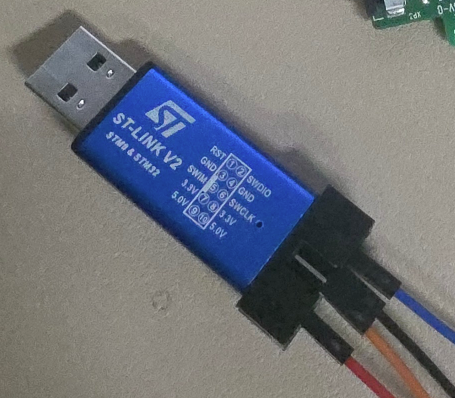
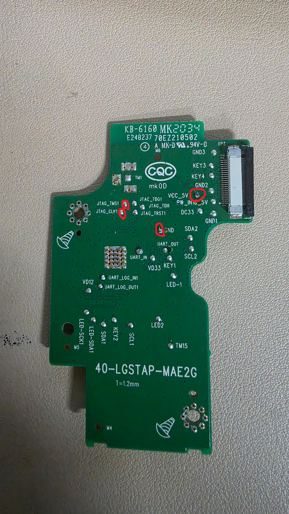

# MTTL-W01 Recovery 1.0.0

[한국어](README.md) | English

[Download recovery tool](https://github.com/af950833/mttl_w01_standalone/releases/tag/recovery-v1.0.0) · [Project](../README_EN.md) · [Third-party components](THIRD_PARTY_NOTICES.md)

A portable Windows x64 tool for reading a **fully detached MTTL-W01 Wi-Fi board** over ST Link V2/SWD and restoring stock 1.0.66 while preserving a verified backup from that same device.

## Mandatory safety conditions

**Unplugging the strip's mains cord alone is not sufficient. Fully disconnect the Wi-Fi board from the AC assembly and every interconnecting lead before connecting ST Link V2/USB/PC. Never connect the AC assembly and wired debug equipment together.**

This is for people capable of verifying power, ground, signal levels and solder connections. Low-voltage labels do not prove isolation. Do not change wiring while powered. Software cannot prevent electrical damage caused by unsafe wiring or power.

## Scope and validation

- Windows x64, ST Link V2 and SWD. Install the USB driver separately.
- Only the known Cortex-M3/1MiB flash/boot-code fingerprint and 0xB000/0x80000 slot layout are accepted.
- Restores stock firmware **1.0.66**.
- Korean/English GUI, double-backup, diagnosis, image planning, bounded writes, full readback verification and reset are implemented.
- Offline fault-injection/workflow and frozen EXE checks passed. **Physical write and recovery boot have not been tested with this integrated tool.** Prior use of related OpenOCD routines is not equivalent to validating this application.
- Compatibility with all board variants, successful recovery and power-loss safety are not guaranteed.

## Requirements and download

1. Get `MTTL-Recovery-1.0.0-Windows-x64.zip` and its checksum from [Recovery 1.0.0 Release](https://github.com/af950833/mttl_w01_standalone/releases/tag/recovery-v1.0.0).
2. Extract the whole ZIP into a writable folder. Do not move the EXE alone. A short ASCII path such as `D:\MTTL-Recovery` is recommended.
3. If necessary, install [ST's STSW-LINK009 USB driver](https://www.st.com/en/development-tools/stsw-link009.html). This tool does not install or replace USB drivers.
4. Internet access is required on first use. OpenOCD is downloaded from its official release and the stock FWR from the existing published repository; both are checked against pinned SHA-256 values. Sources/hashes are in [third-party notices](THIRD_PARTY_NOTICES.md).
5. Keep the prepared folder for offline use. No permanent PATH/environment/registry changes, SDK/compiler or Python installation are required. Download restrictions or security policies stop preparation before target access; do not disable the entire firewall.

## ST Link V2 wiring photos

### ST Link V2 adapter

This is the ST Link V2 adapter used by the user. Do not identify signals by wire colour alone; verify your own adapter's pin labels and actual outputs.

### Wi-Fi board pad locations

The red marks show the pads used on the user's board. Check silk labels and actual pads with power off. Board variants and ST Link V2 clones can have different layouts.

| ST Link V2 | Wi-Fi board pad | Purpose |
|---|---|---|
| SWDIO | JTAG_TMS1 | SWD data |
| SWCLK | JTAG_CLK1 | SWD clock |
| GND | GND | Common ground |
| Verified 5V power output | VCC_5V | Detached Wi-Fi board supply |

The upper-right red circle is **VCC_5V**, not the nearby GND2 pad. The user confirmed operation with this board and their own adapter's 5V output; this does not establish every adapter's output capability. Verify the actual 5V output and available current, and never feed a second supply simultaneously. **Never connect 5V to SWDIO, SWCLK, DC33 or VD33.** Debug signals must match the board's 3.3V logic. TDI/TDO/TRST are unused for two-wire SWD.

## Operation

1. Verify isolation, wiring, power and driver, then run `MTTL-Recovery.exe`. Launching the app alone does not connect to a target.
2. Choose Korean/English at the top right. Language/mode changes and closing are blocked while a job runs.
3. Select the safety-confirmation checkbox.
4. The default is **diagnosis/double-backup only**. Initially use Start in this mode to check the connection and backups.
5. For restoration, select **Restore stock firmware**, choose the reference FWR (prepared on first use), then Start. The remaining workflow is automatic.
6. Do not suspend the PC, disconnect power/USB or force-close the app once writing has begun. Stage/status and detailed logs show progress.
7. On success, reset is requested after writing and full readback verification. Actual boot and setup AP must be checked separately. Use the stock main-button hold to enter provisioning.

## Automatic workflow

1. Check application/runtime integrity and prepare missing files.
2. Identify ST Link V2, CPU and flash; stop unsupported targets.
3. Read the entire 1MiB flash twice. Save matching originals and SHA-256.
4. Diagnose boot code, slots and protected boundaries. Failed/mismatching backups never permit writes.
5. Generate a recovery image from that device's own dump, without importing donor identity data.
6. Write/verify slot 2 and make it bootable before replacing/verifying slot 1. Final signatures: slot 1 NEW, slot 2 OLD.
7. Clear standalone settings at **0xEE000–0xEFFFF**. Unknown data in settings-sector tails stops recovery.
8. Read back the full flash and compare byte-for-byte with the expected image. Request reset only on an exact match.

A full recovery image is generated, but only intended changed regions are programmed. 0x00000–0x0AFFF and 0xF0000–0xFFFFF are preserved. There is no mass-erase or donor-full-image operation. This does not directly clear the stock firmware's own registration information.

## Backup and diagnostic files

The app saves files under `sessions/<timestamp-unique-id>/`:

- `backup-1.bin`, `backup-2.bin`: complete original reads from the device.
- `backup-verified.json`: backup agreement and diagnosis.
- `recovery-image-PRIVATE.bin`, `plan.json`: expected recovered image and write ranges.
- `readback.bin`, `verified-before-reset.json`: final readback and verification.
- `result.json`, `error.txt` on failure, and `openocd.log`: outcome, failure position and logs.

Files exist only once their stage is reached. **Dumps can contain passwords and device-specific information. Do not upload the entire session folder to an issue or use it to restore another device.** Use the Backup/logs folder button to open it. Each job creates a unique folder rather than overwriting previous backups.

## Troubleshooting

- Adapter not found: check driver, USB cable, board power, SWDIO/SWCLK/GND. Connect only one debug adapter.
- Backups differ: check solder joints, contacts, power and signals. The tool does not invent corrections or force writes.
- Unsupported boot/layout: stop; do not bypass checks.
- Write/readback failure: no reset is requested; CPU halt is attempted. Keep the original backup/logs and do not arbitrarily power-cycle to attempt boot.
- Diagnosis-only success: CPU remains halted. After the job fully ends, power cycle the detached board to attempt normal boot.
- Verified writing is not automatic proof of successful boot or electrical safety.

## Source, validation and licenses

[Validation scope](TEST_RESULT.md) · [MIT license](LICENSE) · [Third-party notices](THIRD_PARTY_NOTICES.md)

Application source and matching GPL flasher source are supplied in this folder and the ZIP. `--self-test` prepares dependencies and checks GUI/languages/FWR decoding/runtime integrity/OpenOCD version, saving `self-test.json`. It does not connect to ST Link V2 or read/write a target.
